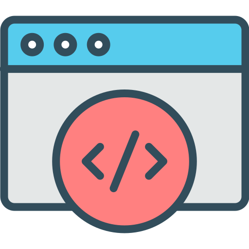
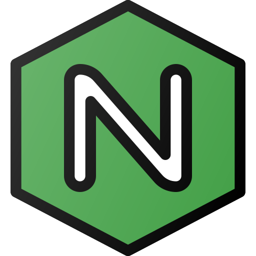
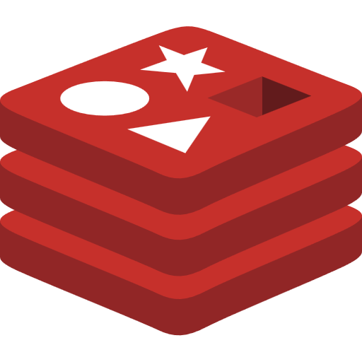
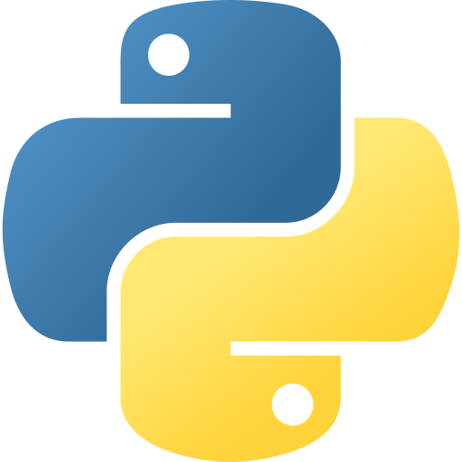

<div align="center">



# dev-stack

**A modern, blazing-fast, and hardened local web development environment for Windows & Linux.**

[](https://flutter.dev)
[](https://dart.dev)
[](#-supported-platforms)
[](#-code-quality--testing)
[](#-license)

<p align="center">
  Similar to <b>Laragon</b> or <b>Laravel Herd</b>, but engineered natively with <b>Flutter Desktop</b> using Clean Architecture. Features multi-webserver switching (Nginx, Caddy, Apache), multi-version PHP isolation with Composer, diverse database engines (MySQL, PostgreSQL, Redis, MongoDB), automated local SSL certificates, portable runtime bundles on Linux, and enterprise-grade security hardening.
</p>

---

</div>

## 📑 Table of Contents

- [✨ Key Features](#-key-features)
- [🛡️ Security Hardening](#️-security-hardening)
- [📦 Supported Applications & Services](#-supported-applications--services)
- [🖥️ Supported Platforms](#️-supported-platforms)
- [🚀 Quick Start Guide](#-quick-start-guide)
  - [Prerequisites](#prerequisites)
  - [Building & Running from Source](#building--running-from-source)
  - [Packaging](#packaging)
- [🏛️ Architecture & Design Patterns](#️-architecture--design-patterns)
- [🧪 Code Quality & Testing](#-code-quality--testing)
- [🤝 Contributing](#-contributing)
- [📄 License](#-license)

---

## ✨ Key Features

- **Multi-Webserver Management**: Seamlessly switch between **Nginx**, **Caddy**, and **Apache** with a single click. Automatically generates virtual host configurations and reverse proxies with FastCGI integration.
- **Isolated Multi-version PHP**: Effortlessly toggle between PHP 8.2, 8.3, 8.4, and 8.5. Includes automated Composer installation, PHP-FPM lifecycle management, and extension management.
- **Portable Runtimes on Linux**: PHP, Apache, PostgreSQL and Redis install as self-contained bundles from `devstack-app-builder` rather than through the distribution's package manager. Every bundle carries a `manifest.json` that is validated before anything runs — identity, declared launcher paths, module checksums, symlink escapes — and the services launch from inside the bundle. No distro version drift, no mixing of system and bundle extensions. Nginx uses Jakub Jirutka's static binaries.
- **Robust Database Engine Support**:
  - Run and manage **MySQL**, **MariaDB**, **PostgreSQL**, **MongoDB**, **Redis**, **Elasticsearch**, **Meilisearch**, and **RustFS** (S3-compatible object storage).
  - Built-in GUI tool integrations (**phpMyAdmin**, **HeidiSQL**, **MongoDB Compass**) with single-click access.
- **Modern Language Runtimes (Node.js, Bun, Deno, Go, Flutter, Python)**:
  - One-click installation and management for **Node.js** (including npm, npx, corepack shims), **Bun** (with bunx), **Deno**, the **Go toolchain** (`go`, `gofmt`) and the **Flutter SDK** (with its bundled Dart SDK).
  - Every version on go.dev and the newest patch of each stable Flutter minor is installable; both are verified against the SHA-256 their publisher reports before anything is unpacked.
  - Automatically configures isolated global package directories (`~/.bun/bin`, `~/.deno/bin`, `%APPDATA%\npm`, `~/.npm-global/bin`) merged into the User PATH. Go also gets `GOROOT`; Flutter gets its `bin/` on PATH and one launcher run during install so a damaged extraction fails there rather than on the user's first command.
  - Python runtime management via **pyenv**.
- **Supervisor**: Register long-running programs, start/stop/restart them, follow their output live, and let the watchdog restart a crashed program after an exponential backoff — up to 5 restarts per 60-second window by default, all configurable per program. Auto-start entries are honoured on launch and every process tree is killed on shutdown.
- **Cron Scheduler**: Schedule shell jobs with a 5-field cron expression or a preset (`@hourly`, `@daily`, …), preview the next run, and keep a per-job run history. The in-app scheduler never overlaps two runs of the same job: a tick that finds the previous run still going is skipped.
- **Log Viewer**: Follow `~/.ponta/logs` (or `%BASE_DIR%\logs`) by source with a bounded reader — it anchors at the tail and reads at most 1 MB / 4000 lines, so opening a large log is instant rather than a multi-second freeze.
- **Instant Public Tunneling (Cloudflare & ngrok)**:
  - Driver-based Tunnel Subsystem supporting **Cloudflare Quick Tunnels** (100% zero-config, no account needed), **Cloudflare Named/Tunnel-token** tunnels, and **ngrok**.
  - Real-time tunnel session dashboard with status badges, 1-click URL copying, QR code generation for mobile testing, the ngrok Web Inspector (`http://127.0.0.1:4040`), and 1-click sharing directly from the Sites table.
  - Optional auto-start on app launch.
- **Automated Virtual Hosts & Local SSL**:
  - Site domains of any local suffix (`.test`, `.local`, …) are routed through the system hosts file; the default template for a new site is `[site-name].test`. `/etc/hosts` and the Windows hosts file are written with an elevated copy of a `0600` temporary file.
  - Automatically provisions trusted local **SSL (HTTPS)** certificates using an internal Root Certificate Authority (**mkcert**).
  - Every privileged step asks first: the exact command line is shown and only ALLOW proceeds. A "no" is remembered, so the question does not return on every launch. The app also offers to install `nss-tools`/`libnss3-tools` (the `certutil` that Firefox and Chrome need) with the right package manager for the distro, and reports the start and the outcome of each step.
  - Robust Linux support with PolicyKit (`pkexec`) elevation, user `CAROOT` synchronization, and automatic permission chown back to the active user.
- **Integrated Configuration Editor**: Edit configuration files (`php.ini`, `nginx.conf`, `httpd.conf`, `Caddyfile`, `my.ini`, `mongod.cfg`, …) directly within the application, with syntax highlighting chosen by file type, a lazy viewport that handles large files, and a save path that reports a failure instead of silently discarding the edit.
- **Responsive Desktop UI**: Tables ellipsize their cells and collapse the row action cluster into an overflow menu as the window narrows; the sidebar folds to icons-only and auto-collapses. The window opens at 1080×720 and cannot be resized below 720×520.
- **System Tray & Auto-Start Integration**: Minimizes unobtrusively to the system tray and provides optional automatic background service startup upon system boot.
- **Notifications that survive dialogs**: every success and progress message is a toast from `toastification`, and every error is an alert the user has to acknowledge. Neither is a `SnackBar`, which is anchored to a `Scaffold` and disappears the moment a dialog closes over it.

---

## 🛡️ Security Hardening

`dev-stack` has been audited and hardened across multi-phase security benchmarks to ensure defense-in-depth:

| Security Domain | Protection Mechanism & Implementation |
| :--- | :--- |
| **Supply Chain Security** | Streaming **SHA-256** verification of downloaded archives against the catalog's per-version digest before extraction; catalog URLs are rejected unless their scheme is **HTTPS**; each installed bundle's `manifest.json` is validated (identity, version match, declared paths, module checksums) before any launcher is executed. |
| **No Catalog-Executed Commands** | The installer never runs a shell command supplied by the catalog. Package-manager installation was removed entirely: an app is downloaded, verified, extracted and configured, never "installed by command". |
| **Encrypted Local Storage** | Database passwords and API tokens are encrypted by `LocalSecretVault`: a random 256-bit key file (created with `0600` permissions), a random IV per ciphertext, a SHA-256 keystream, and an HMAC-SHA256 authentication tag. Tampered or foreign ciphertext is rejected. Legacy plaintext values are read transparently but never written back as plaintext. |
| **Path Traversal Defense** | Tar archives are listed with `tar -tf` and every entry is validated (`isSafeTarEntry`) before extraction; ZIP entries are canonicalized and written only when the destination stays inside the target directory. Unsafe entries are skipped and logged. |
| **Privilege Escalation & Polkit Isolation** | Elevation is per-operation, never a long-lived root shell: a single `pkexec` call for the hosts file copy or the mkcert install. Environment variables are forwarded as explicit positional arguments (pkexec strips them), the mkcert wrapper runs with `set -e`, and the user's `CAROOT` is chowned back so they keep ownership of the CA key. A dismissed authentication dialog (exit 126) is reported as cancelled, never as success. |
| **Least-Privilege File Permissions** | Temporary files used before an elevated copy are tightened to `0600`; the vault key file is `0600`; app directories get `u+rwX,go+rX,go-w` rather than blanket `755`. Ports below 1024 are handled with a per-binary `cap_net_bind_service` capability instead of running the webserver as root. |
| **Process Lifecycle Reliability** | POSIX process-group kill on Linux (`kill -9 -- -$pid`, only when the root leads its own group) prevents orphaned worker leaks; the process table is read once per kill, not once per node. The supervisor's backoff waits are released and its trees killed on shutdown. |
| **Audit Logging** | Every elevated command is logged before it runs (`Audit: executing elevated command with pkexec: …`) and its exit code is recorded afterwards. |

---

## 📦 Supported Applications & Services

<div align="center">

| Web Servers | Language Runtimes | Databases & Storage | Management & Tunnels |
| :---: | :---: | :---: | :---: |
| <br/>**Nginx** | <br/>**PHP 8.2 – 8.5** | <br/>**MySQL** | <br/>**phpMyAdmin** |
| <br/>**Caddy** | <br/>**Node.js** | <br/>**MariaDB** | <br/>**HeidiSQL** ¹ |
| <br/>**Apache** | <br/>**Bun (bunx)** | <br/>**PostgreSQL** | <br/>**MongoDB Compass** ¹ |
| | <br/>**Deno** | <br/>**Redis** | 🌐<br/>**Cloudflare Tunnel** |
| | <br/>**Go** | <br/>**MongoDB** | 🚇<br/>**ngrok** |
| | <br/>**Flutter** | <br/>**Elasticsearch** | |
| | <br/>**Python (pyenv)** | <br/>**Meilisearch** | |
| | | <br/>**RustFS** | |

</div>

<sub>¹ Windows only. The Linux catalog ships the server-side apps and phpMyAdmin; HeidiSQL and MongoDB Compass are Windows desktop tools.</sub>

---

## 🖥️ Supported Platforms

- **Windows**: Windows 10 & Windows 11 (64-bit architecture). Applications install under the configured base directory, `C:\Ponta` by default, and the Inno Setup installer records it in `DEVSTACK_BASE_DIR`.
- **Linux**: Ubuntu, Debian, Fedora, Arch Linux, openSUSE, and Alpine Linux.
  - Automatic distribution detection via `LinuxDistroResolver` (it resolves catalog placeholders such as `{mongo_distro}`).
  - Data and apps live under `~/.ponta` by default.
  - Portable runtimes: musl-dynamic bundles from `devstack-app-builder` (PHP, Apache, PostgreSQL), a static musl bundle for Redis, and Jakub Jirutka's static nginx binaries.
  - The Go and Flutter SDKs come from their own publishers (`go.dev/dl`, `flutter_infra_release`), so the catalog's SHA-256 checks are the ones those projects publish; a mismatched download is rejected before extraction.
  - The `.deb`/`.rpm` packages install to `/opt/dev-stack` and expose `dev_stack` (and `dev-stack`) on `PATH`; the `.desktop` entry launches that symlink.

---

## 🚀 Quick Start Guide

### Prerequisites

- **Dart SDK**: `^3.10.4`; the project is built and tested on **Flutter 3.47.x** (`stable`).
- **Windows**: Visual Studio 2022 with the "Desktop development with C++" workload.
- **Linux**: `clang`, `cmake`, `ninja-build`, `pkg-config`, `libgtk-3-dev`, `liblzma-dev`, `libayatana-appindicator3-dev`.
- **Optional on Linux**: `nss-tools`/`libnss3-tools` (the `certutil` binary mkcert needs so Firefox and Chrome trust the local CA). The app offers to install it when it is missing.

### Building & Running from Source

1. **Clone the repository**:
   ```bash
   git clone https://github.com/ngotuananh101/dev-stack.git
   cd dev-stack
   ```

2. **Install project dependencies**:
   ```bash
   flutter pub get
   ```

3. **Generate code bindings (Isar & Riverpod Generators)** *(required when modifying models or providers)*:
   ```bash
   dart run build_runner build --delete-conflicting-outputs
   ```

4. **Launch the application**:
   - On **Windows**:
     ```bash
     flutter run -d windows
     ```
   - On **Linux**:
     ```bash
     flutter run -d linux
     ```

### Packaging

Both packaging paths embed build metadata — the build timestamp, the git commit, the Flutter/engine revisions — by running `scripts/gen_build_info.dart` and passing its output to `flutter build --dart-define-from-file=.dart_tool/build_info.json`. Plain `flutter build` skips this, and the in-app System Diagnostics modal reports such a binary as a development build instead of inventing a timestamp.

The same modal shows the platform report: on Windows the verbatim `systeminfo` dump, on Linux a structured block built by `LinuxSystemProbe` from `/etc/os-release`, procfs, `/sys/class/dmi/id`, and whichever of `uname`, `getconf`, `lscpu`, `df`, `ip` and `lspci` are installed. A section whose sources are all missing is omitted rather than filled with placeholders.

**Windows installer (Inno Setup)** — install **Inno Setup 6 or 7** from [jrsoftware.org](https://jrsoftware.org/isdl.php), then:

```powershell
.\scripts\package.ps1
```

The installer is written to `innosetup\Output\`. The local script uses the version defined in `innosetup\installer.iss`; the release workflow overrides it with `pubspec.yaml`'s version via `/DMyAppVersion=`.

**Linux** — the release workflow is the canonical packager: `.github/workflows/build-assets.yml` installs the build dependencies and produces the AppImage, `.deb` (fpm), `.rpm` (fpm), `.tar.gz` and `.zip`. For a local build with the same dependencies, `scripts/package-linux.sh` builds the tarball and AppImage from a `flutter build linux --release`:

```bash
flutter build linux --release
./scripts/package-linux.sh
```

The `.deb`/`.rpm` post-install hook (`packaging/linux/postinstall.sh`) refreshes the desktop and icon caches so the app appears in the menu without logging out.

**Releases** — `Build Assets` is a `workflow_dispatch` workflow with a checkbox per artifact format plus `create_release`/`release_tag`. It also uploads the files as workflow artifacts when no release is created.

---

## 🏛️ Architecture & Design Patterns

The codebase follows **Clean Architecture** principles and leverages **Riverpod** for reactive state management:

```
lib/
├── core/
│   ├── config/             # Config Builders (Nginx, Caddy, Apache) & AppConfig
│   ├── database/           # Isar Singleton Provider & Concurrency Mutex Lock
│   ├── security/           # LocalSecretVault (HMAC-SHA256 authenticated encryption)
│   ├── services/           # SSL, Path, Process, Logging, Window/Tray, Distro Resolver
│   └── theme/              # Typography, Colors, Themes
├── features/
│   ├── apps/               # Catalog, Install Pipeline, Runtime Bundles, PHP Settings
│   ├── cron/               # Cron Expressions, Jobs, Scheduler
│   ├── databases/          # Database Records, Credential Encryption, User Grants
│   ├── hosts/              # Virtual Hosts, Local Domain Resolution, System Hosts
│   ├── logs/               # Log Sources and the Tail-Anchored Viewer
│   ├── settings/           # Base Directory, Site Template, Tray/Auto-Start, LAN, Root Certificate
│   ├── sites/              # Projects, Virtual Hosts, SSL Certificates, Batch Create
│   ├── supervisor/         # Long-running Programs, Watchdog, Backoff Restart
│   ├── system/             # OS / Hardware / Environment Information
│   └── tunnels/            # Tunnel Drivers (Cloudflare, ngrok), Sessions, QR Sharing
└── shared/                 # Reusable Widgets, Code Editor, Dialogs, Log Tail Reader
```

### Key Design Patterns
- **Builder Pattern**: Static configuration generators (`NginxConfigBuilder`, `ApacheConfigBuilder`, `CaddyConfigBuilder`) producing clean, normalized configuration files across Windows and POSIX systems. Apache gets an isolated `httpd.conf` generated for the bundle's own layout.
- **Strategy & Pipeline Pattern**: Decomposed `AppInstallerService.install()` into modular phases: download ➔ SHA-256 verification ➔ archive extraction ➔ manifest validation ➔ database configuration ➔ runtime configuration ➔ webserver integration.
- **Manifest-Validated Bundles**: `PhpRuntimeBundle` (and the shared `runtime_bundle.dart` reader) resolve every launcher, INI and extension path from `manifest.json`, rejecting absolute paths, `..` segments, symlink escapes and checksum mismatches before a single process is started.
- **Driver Pattern**: Pluggable `TunnelDriver` architecture (`CloudflareDriver`, `NgrokDriver`) decoupling protocol-specific tunneling logic, Web Inspector, and status monitoring from UI and state management.
- **Single-Flight / Async Mutex Pattern**: Concurrency lock using `Completer<Isar>` in `IsarInstance.getInstance()` to eliminate race conditions and file lock contentions during application boot.
- **Injectable Side Effects**: Privileged flows (`SslService.ensureCertutil`, `initializeRootCA`, hosts writes, process kills) take their runner and prompt as parameters, so the behaviour — including declined prompts and exit codes — is tested without touching the machine.

---

## 🧪 Code Quality & Testing

`dev-stack` enforces strict Test-Driven Development (TDD) standards:

- **Full suite green**: **1059 / 1059 tests PASS** (0 failures, 0 skipped) — the exact count `flutter test` prints on the current tree.
- **Clean Static Analysis**: `flutter analyze` reports **0 issues**; `dart format --set-exit-if-changed lib test` is clean.
- **Comprehensive Test Coverage**:
  - Unit tests for all Webserver Config Builders (Nginx, Apache, Caddy).
  - Security regression test suites for Tar Path Traversal, Zip extraction escapes, SHA-256 checksums, and authenticated-keystore tampering.
  - OpenSSL-backed tests for root-CA trust detection, including the same-subject-CA bundle ordering that a plain `openssl verify` gets wrong.
  - Installation-flow tests for the portable manifests, PHP extension toggles, and the certutil install (prompts, declines, exit codes, and a "success" that leaves the binary off the PATH).
  - Driver test suites for Tunnel downloaders, lifecycle processes, and UI modals.
  - Mock integration tests for POSIX signals and process-group termination.

Run all tests:
```bash
flutter test
```

Perform static analysis and formatting check:
```bash
flutter analyze
dart format --set-exit-if-changed lib test
```

---

## 🤝 Contributing

Contributions, bug reports, and feature requests are welcome!

1. Fork the repository.
2. Create your feature branch (`git checkout -b feature/AmazingFeature`).
3. Commit your changes (`git commit -m 'feat: add some AmazingFeature'`).
4. Push to the branch (`git push origin feature/AmazingFeature`).
5. Open a Pull Request.

---

## 📄 License

This software is proprietary; all rights reserved by the author.

<div align="center">
  <sub>Built with ❤️ for the global developer community.</sub>
</div>
